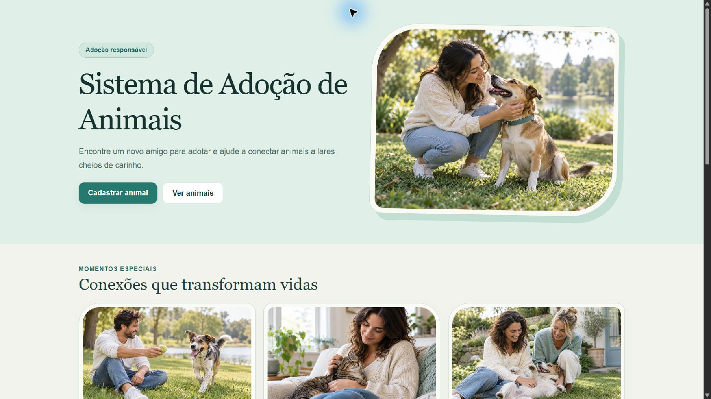
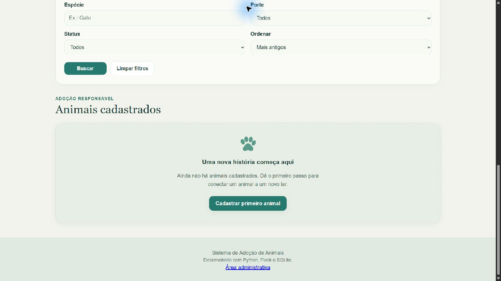
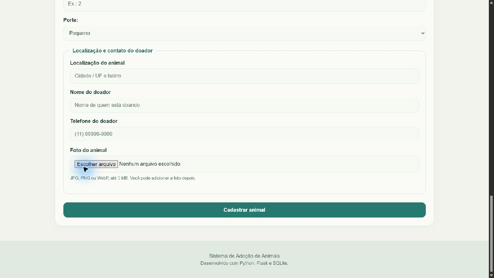

# Sistema de Adoção de Animais 🐾

Aplicação web em **Python, Flask e SQLite** para conectar animais a novos lares. Inclui cadastro de animais, informações do doador, localização, fotos e uma área administrativa protegida.

**[Acessar o site](https://felipegab11.pythonanywhere.com/)** · **[Área administrativa](https://felipegab11.pythonanywhere.com/entrar)**

Projeto de portfólio desenvolvido por **Felipe**, evoluindo de um programa de terminal para uma aplicação web publicada. **Versão 1.0.0.**

## Prévia



<details>
<summary>Ver pesquisa e cadastro</summary>





</details>

As capturas mostram a interface do projeto. As imagens de apresentação foram geradas por IA e não representam os animais cadastrados.

## Funcionalidades

- Cadastro, listagem, edição, adoção e exclusão de animais por ID.
- Busca por nome ou espécie; filtros por espécie, porte e status.
- Ordenação por cadastro, nome e idade.
- Nome e telefone do doador, localização do animal e foto em cada cadastro.
- Envio de fotos JPG, PNG ou WebP de até 5 MB, com validação e armazenamento local no servidor.
- Persistência em SQLite e atualização automática das colunas dos cadastros antigos.
- Mensagens de sucesso, erros de validação e confirmação de exclusão em modal.
- Interface responsiva em branco suave e verde água.
- Na versão pública, consulta aberta e alterações restritas ao administrador.
- Login com senha armazenada por hash, sessão com expiração, proteção CSRF e limite de tentativas.

## Tecnologias

| Camada | Tecnologias |
| --- | --- |
| Aplicação | Python, Flask e Jinja |
| Dados | SQLite e `sqlite3` |
| Interface | HTML5, CSS3 e JavaScript |
| Imagens | Pillow |
| Testes | `unittest`, cliente de testes do Flask e bancos temporários |
| Hospedagem | PythonAnywhere, com entrada WSGI |

## Executar localmente

Recomendado: **Python 3.13**, usado na hospedagem. O projeto também foi testado localmente em Python 3.14.

```powershell
git clone https://github.com/felipe110606/sistema-adocao-python.git
cd sistema-adocao-python
python -m venv .venv
.\.venv\Scripts\python.exe -m pip install -r requirements.txt
.\.venv\Scripts\python.exe app.py
```

No macOS ou Linux, use `python3 -m venv .venv` e substitua `.\.venv\Scripts\python.exe` por `.venv/bin/python` nos comandos seguintes.

Abra **http://127.0.0.1:5000/**. O banco é criado automaticamente, e um clone novo começa sem cadastros. Encerre com `Ctrl+C`.

O modo local permite gerenciar os animais diretamente e usa o servidor de desenvolvimento. Para a versão pública, use a configuração WSGI e o login administrativo descritos em [PUBLICAR.md](PUBLICAR.md).

## Testes

```powershell
.\.venv\Scripts\python.exe -m unittest discover -s tests -v
```

São **16 testes** cobrindo CRUD, validações, persistência, IDs estáveis, migração do banco, fotos, filtros, mensagens, login, CSRF, bloqueio de alterações sem autenticação e limite de tentativas. Os testes usam bancos e pastas temporários, sem alterar os cadastros reais.

## Estrutura

```text
sistema-adocao-python/
├── app.py                     # Rotas, formulários e fotos
├── acesso.py                  # Login e proteção da versão pública
├── banco.py                   # Conexão, migração e operações SQLite
├── wsgi.py                    # Entrada de produção
├── configurar_publicacao.py   # Configuração administrativa no servidor
├── sistema_adocao.py           # Versão original de terminal
├── templates/                 # Páginas Jinja
├── static/                    # Estilos e imagens de apresentação
├── tests/                     # Testes automatizados
├── docs/screenshots/          # Capturas para o portfólio
├── requirements.txt
└── PUBLICAR.md                # Guia de hospedagem
```

Durante o uso, `adocao.db` armazena os cadastros, `uploads/animais/` armazena suas fotos e `instance/` guarda a configuração privada da hospedagem. Esses arquivos ficam fora do Git.

## Como funciona

Um formulário envia os dados ao Flask; o servidor valida os campos e executa as operações SQL com parâmetros. Depois, redireciona para a listagem e apresenta o resultado com Jinja e mensagens de feedback.

Os IDs permanecem estáveis após exclusões, nomes podem se repetir e editar um animal preserva seu status de adoção. As fotos recebem nomes únicos e são convertidas para JPEG; uma nova foto substitui a anterior.

## Publicação e manutenção

O site está disponível em **https://felipegab11.pythonanywhere.com/**. A senha administrativa é configurada diretamente no servidor e não está no repositório. Veja [PUBLICAR.md](PUBLICAR.md) para configurar uma nova instalação.

O plano gratuito do PythonAnywhere exige extensão mensal no painel e possui limite de armazenamento. Faça backup de `adocao.db` e `uploads/animais/` juntos; o GitHub guarda o código, não os cadastros. Dados criados localmente e na hospedagem são independentes.

## Aprendizados

Este segundo projeto de estudos reuniu lógica Python, rotas HTTP, templates, formulários, validação, SQL, arquivos, autenticação, testes e publicação. O histórico das etapas está em [ETAPAS.md](ETAPAS.md).

O escopo da **v1.0** está concluído: um sistema de adoção funcional, documentado e publicado, com a versão original de terminal preservada.
